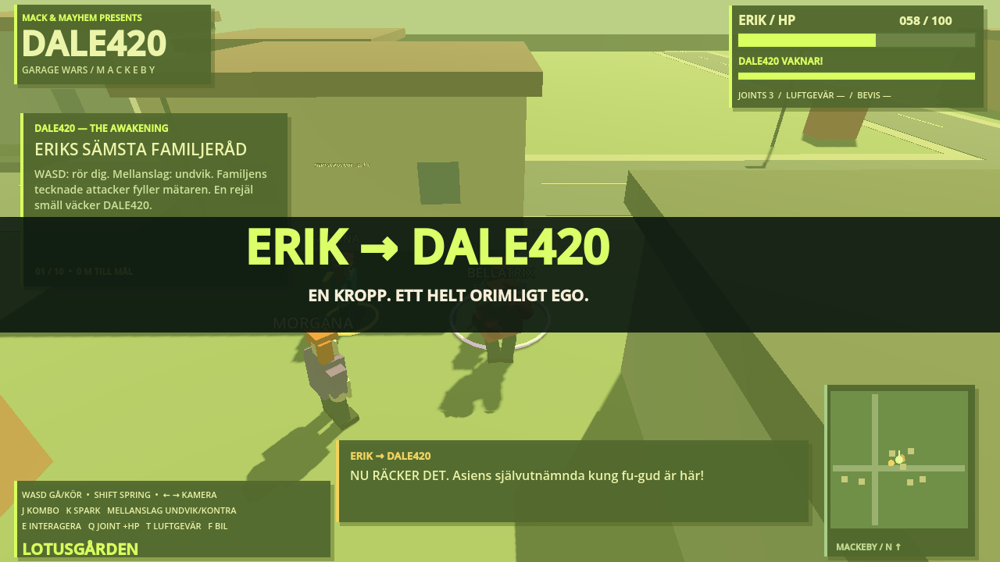

# DALE420 — Garage Wars: The Awakening

Playable native Godot 4.7 continuation of the available Alpha 01 WebGL prototype. Erik and DALE420 are the same player: a skinny, pale, ginger, unemployed 25-year-old who awakens a wildly overpowered kung fu alter ego when his ginger family provokes him.



Requires **Godot 4.7** (validated with 4.7.2). Python 3 is only needed for the verification runner.

Clone the repository and open `project.godot` in Godot, then press **F5**:

```bash
git clone https://github.com/CipherCuttle/dale420-garage-wars.git
cd dale420-garage-wars
godot --path .
```

Press **Enter** at the title screen. All in-game dialogue and objectives use Swedish comedy. The family fights use cartoon impacts, telegraphs and “fikapaus” defeats. Characters, geometry and sound effects are procedural originals.

| Key | Action |
| --- | --- |
| WASD / Shift | Walk / sprint; WASD also drives |
| Left/right arrows | Orbit camera |
| Hold right mouse / wheel | Orbit / zoom camera |
| Space | Dodge; DALE420 counters nearby attacks during a dodge |
| J / K | Weak slap/kick as Erik; three-hit kung fu combo/power kick as DALE420 |
| E | Interact with your forest stash and crumb evidence |
| Q | Use one joint for +28 HP as a fictional arcade mechanic |
| T | Fire your air rifle at the hideout target with arcade aim assist; world geometry blocks shots |
| F | Enter/exit the yellow sports car after defeating Lotusmicke |
| R / Enter after defeat | Retry the latest checkpoint |

The mission starts at Erik's home, introduces the three sisters and the first awakening, then leads to Erik's forest hideout, healing, air-rifle practice, secret sandwich crumbs, a return fight with the sisters, Lotusmicke's garage boss fight, the car key and free roam. The car points toward the road; use W to drive out, S to reverse.

The `ErikDale420` node remains alive through every transformation. Its HP and inventory remain on that node. `AwakeningState` only owns combat-mode state: **ERIK → AWAKENING → DALE420 → RECOVERY → ERIK**. The default transformation lasts 22 seconds after a one-second introduction. Recovery lasts 12 seconds. Each mission encounter grants at most one awakening, with per-attacker credit limits and duplicate-hit protection. Returning to the same arena never refills the budget. The home tutorial ends the sisters' attacks after three kung fu hits including a kick; expiration still returns Erik to normal and starts the escape.

Select the root's `config` resource in Godot, or edit `garage_wars_config.tres` / `scripts/config.gd`, to tune duration, thresholds, cooldowns, damage, movement and healing.

Checkpoints retain their captured HP, inventory and mission phase. Retry restores that snapshot with normal Erik, empty fury, a fresh encounter budget and the appropriate enemies. Boss retry preserves the air rifle and crumb evidence. Progress is in memory for this session; there is no disk save system.

Run validation:

```bash
python3 tests/verify.py --godot /path/to/Godot --render
```

Omit `--render` on a machine without a display. The runner imports in the actual Godot editor, runs native gameplay and input/state tests, rejects engine errors/warnings even when Godot exits zero, scans active scripts for the obsolete objective, and optionally captures GPU screenshots, a transformation WAV and explicitly labeled character fixtures. The last full run passed **32 acceptance checks and 12 input/state checks**, plus the rendered acceptance repeat, with zero engine errors or warnings. See [the verification receipt](evidence/verification.json) and [the implementation report](IMPLEMENTATION_REPORT.md) for results and scope. Raw local logs and Godot caches are excluded from Git.

The original Alpha 01 WebGL archive was preserved separately. This project ports that alpha's procedural district, controls and vehicle rules into Godot; it does not claim integration with a separate Open Theft Auto checkout. None was present locally during the audit.
